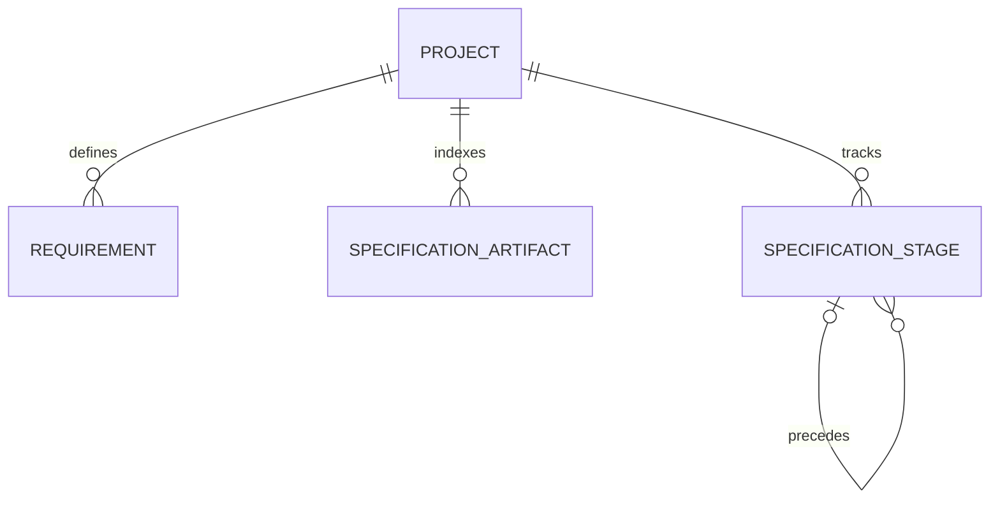

# Entity Model: Project Specifications

`PROJECT` owns the requirements and artifact index for one workspace. `SPECIFICATION_STAGE` records the ordered handoffs.

### PROJECT

One workspace whose specification artifacts share a local registry.

| Attribute | Description | Data Type | Length/Precision | Validation Rules |
|---|---|---|---|---|
| id | Project identity | Long | 19 | Primary Key |
| workspace_root | Absolute workspace directory | String | varies (50-500) | Not Null, Unique |

### REQUIREMENT

One testable condition registered for a project.

| Attribute | Description | Data Type | Length/Precision | Validation Rules |
|---|---|---|---|---|
| id | Requirement identity | Long | 19 | Primary Key |
| project_id | Owning project | Long | 19 | Not Null, Foreign Key (PROJECT.id) |
| requirement_id | Stable requirement identifier | String | varies (50-500) | Not Null |
| title | Requirement name | String | varies (50-500) | Not Null |
| criteria | Testable requirement statement | String | varies (50-500) | Not Null |
| priority | Requirement priority | String | 4 | Not Null, Values: must, should, could, normal |
| status | Requirement lifecycle state | String | 7 | Not Null, Values: active, met, dropped |

#### Constraints

- A requirement_id is unique within one project (project_id, requirement_id are unique together).

### SPECIFICATION_ARTIFACT

One detailed artifact indexed in the project registry.

| Attribute | Description | Data Type | Length/Precision | Validation Rules |
|---|---|---|---|---|
| id | Artifact identity | Long | 19 | Primary Key |
| project_id | Owning project | Long | 19 | Not Null, Foreign Key (PROJECT.id) |
| artifact_id | Stable artifact identifier | String | varies (50-500) | Not Null, Unique |
| artifact_type | Artifact category | String | varies (50-500) | Not Null, Values: business_use_case, entity_model, system_use_case, functional_diagram, interpretation |
| relative_path | Path within the workspace | String | varies (50-500) | Not Null |

#### Constraints

- An artifact path is unique within one project (project_id, relative_path are unique together).

### SPECIFICATION_STAGE

One ordered production and validation stage.

| Attribute | Description | Data Type | Length/Precision | Validation Rules |
|---|---|---|---|---|
| id | Stage identity | Long | 19 | Primary Key |
| project_id | Owning project | Long | 19 | Not Null, Foreign Key (PROJECT.id) |
| name | Stage name | String | varies (50-500) | Not Null, Values: intake, requirements, business_use_cases, entity_model, system_use_cases, functional_diagrams, validation |
| predecessor_id | Direct prerequisite stage | Long | 19 | Optional, Foreign Key (SPECIFICATION_STAGE.id) |
| status | Stage validation state | String | varies (50-500) | Not Null, Values: pending, active, passed, blocked |
