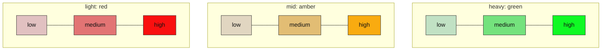

# Color key: model is the hue, effort is the vibrancy

Everything on the party diagrams is read from two positions.

- **Hue = which model.** A red → amber → green gradient with three slots:
  light = red, mid = amber, heavy = green. Slots are absolute, so Sonnet is
  amber in every diagram, and a binding without a heavy model simply has no
  green on its dial. A model that sits between two slots takes the blended hue.
- **Vibrancy = effort.** Within a hue: low is pale and muted, medium is normal,
  high is vivid.

| Slot | Claude | Codex (operator's ids) | low | medium | high |
|---|---|---|---|---|---|
| light (red) | Haiku 5.5 | gpt-5.4-mini | `#e1c1c1` | `#e27474` | `#f91010` |
| mid (amber) | Sonnet 5.5 | gpt-5.4 | `#e1d6c1` | `#e2bd74` | `#f9ab10` |
| heavy (green) | none (Oracle runs Sonnet 5.5 high; no Opus) | gpt-6.1-sol, gpt-6.5-tierra (comparable) | `#c1e1c4` | `#74e27d` | `#10f924` |

Rule, for any other ladder: `hue = 0°` at light, `40°` at mid, `125°` at heavy,
linear between slots; `(saturation, lightness)` = `(35%, 82%)` low, `(65%, 67%)`
medium, `(95%, 52%)` high. All nine colors keep at least 4.6:1 contrast with
the dark node text (`#111111`).

Color is a second channel. Every node still carries the model and effort in
words, because red and green alone fail for red-green color blindness.

Reading a diagram: a pale amber node is Sonnet at low effort; a vivid green
node is the heavy model at high effort. A window that lowers the ceiling
(see the squash rows) shows up as the vivid end of the dial disappearing.
