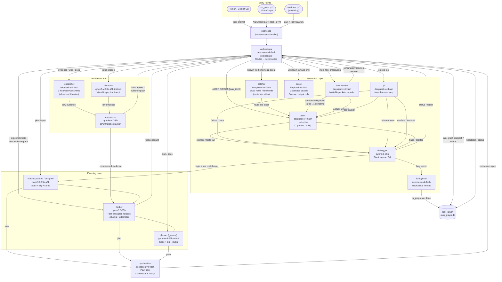

# Diagram 2

## Notes

- Nodes, subgraphs and edge labels are read directly from the image.
- The image has many overlapping lines. Edge endpoints are inferred from label position and arrowheads where lines cross. Least certain: `PI -> AIDER` (edit packet), `THK --- PLG`, `THK -> ORCH` (root constraint), `ORCH -> DB` (heartbeat / status), and which node feeds `DB` besides handyman.
