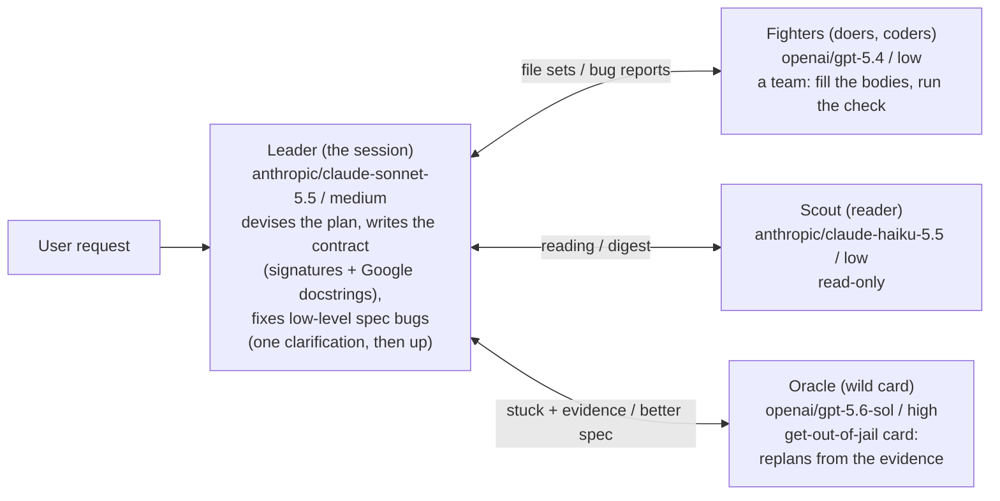

# OpenRouter: the same party, any vendor in the slot

A role is pinned to a **slot** (light, mid, heavy) and an **effort**, never to a
model. Each lane below lists the models slotted into it; at dispatch the harness
takes the first one that is available. Several vendors can share a lane, so the
Leader and the Fighters can sit on different mid-lane models.

Generate the picture with `python mermaid_to_infographic.py openrouter.md`.



## How a role finds its model

```
role  ->  (slot, effort)  ->  first available model in the slot  ->  request with that effort
```

- **Availability** is checked against OpenRouter's live model list
  (`GET https://openrouter.ai/api/v1/models`, no key needed). A listed model with
  `reasoning` in its `supported_parameters` can take the effort dial.
- **Effort** is one dial across vendors: low, medium, high map to the same
  rungs, so squashing and scaling a window works exactly as in
  `party-2-models.md` and `party-3-models.md`.
- **A different vendor for the Oracle** gives the Leader a read that does not share
  his blind spots, at the cost of two vendors' quirks.
