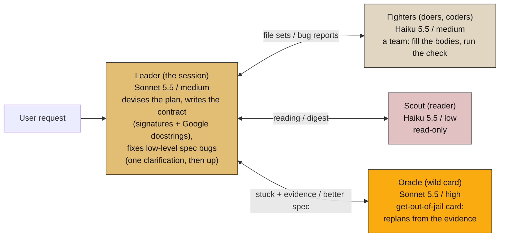
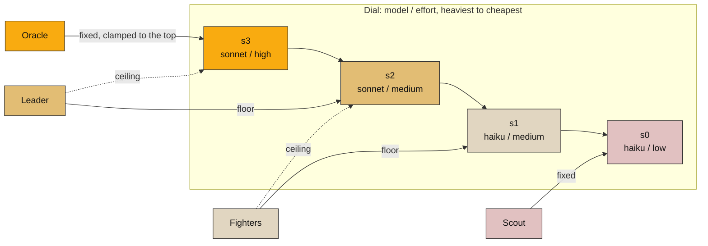

# Party, lower ceiling: two models

Four classes: the **Leader** plans and handles low-level spec bugs, a team of
**Fighters** fills the bodies, the **Scout** reads, and the **Oracle** (a priest,
a wild card of wisdom) is called only to cut a knot the Leader cannot. This
binding has two models (light, mid) and no heavy one, so the dial tops out at
`mid / high` and the Oracle clamps there. This is the live Claude binding
(`tiers.toml`: Haiku 5.5 and Sonnet 5.5, never Opus).

## Diagram 1 — the party and the flow

A Fighter that hits a bug reports it. The Leader gets one clarification attempt; only what he cannot
resolve goes up to the Oracle, the get-out-of-jail card, who replans from the evidence (the Fighters' reports, the attempted fix and the failed clarification). His better spec comes back to the Leader to be
re-cut into file sets for the Fighters.

## Diagram 2 — the dial, and where each class sits

No green on this dial: the ceiling is amber at high effort. The Oracle wants the
heavy model and clamps to the top step; a Leader widened to high effort reaches
the same step, so at the top they think at the same level and differ only in
role and gear.

## Windows: min, max, squash, scale

A window `[min .. max]` clamps every class to the nearest step inside it. Roles
that land on the same model and effort squash into one context (no handoff).

| Window | Scout | Fighters | Leader | Oracle | What happened |
|---|---|---|---|---|---|
| `s0..s3` (full) | haiku/low | haiku/med | sonnet/med → sonnet/high | sonnet/high | four brains; the top is shared by a widened Leader and the Oracle |
| `s1..s3` (**min** = haiku/med) | haiku/med | haiku/med | sonnet/med → sonnet/high | sonnet/high | **squash**: Scout lifts onto the Fighters' settings and the two become one role |
| `s0..s2` (**max** = sonnet/med) | haiku/low | haiku/med | sonnet/med | sonnet/med | **squash**: the Oracle falls onto the Leader's settings; there is nobody above, so the Leader keeps the problem |
| `s2..s2` (min = max) | sonnet/med | sonnet/med | sonnet/med | sonnet/med | everything squashed: one role, the party is only gear |

Scale up: add a heavy model and the Oracle splits off the top; that is
`party-3-models.md`. The two-model binding is the three-model window `t0..t3`.
