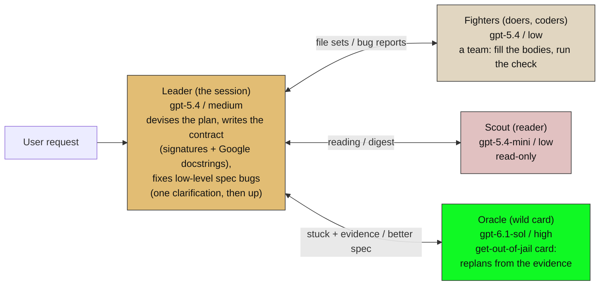
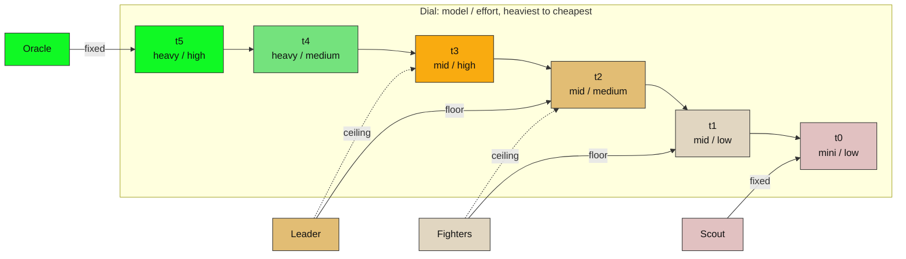

# Party, higher ceiling: three models

Same four classes and the same flow as `party-2-models.md`. This binding has three
models (light, mid, heavy), so the dial reaches `heavy / high` and the Oracle gets a
brain of his own. Example ids are from the operator's Codex diagram: `gpt-5.4-mini`,
`gpt-5.4`, and the heavy tier of `gpt-6.1-sol` and `gpt-6.5-tierra` (comparable).

## Diagram 1 — the party and the flow

A Fighter that hits a bug reports it. The Leader gets one clarification attempt; only what he cannot
resolve goes up to the Oracle, the get-out-of-jail card, who replans from the evidence (the Fighters' reports, the attempted fix and the failed clarification). His better spec comes back to the Leader to be
re-cut into file sets for the Fighters.

## Diagram 2 — the dial, and where each class sits

Steps run left to right from heaviest to cheapest (thinking reads from the highest
on the left). A class is pinned to a **floor** (solid line, where it starts) and a
**ceiling** (dotted line, how far the Leader may slide it at dispatch).

## Windows: min, max, squash, scale

A window `[min .. max]` clamps every class to the nearest step inside it. Roles
that land on the same model and effort squash into one context (no handoff).

| Window | Scout | Fighters | Leader | Oracle | What happened |
|---|---|---|---|---|---|
| `t0..t5` (full) | mini/low | mid/low → mid/med | mid/med → mid/high | heavy/high | full spread, four distinct brains |
| `t0..t3` (**max** = mid/high, no heavy model) | mini/low | mid/low → mid/med | mid/med → mid/high | mid/high | **squash** at the top: the Oracle and a widened Leader share a brain |
| `t1..t4` (**min** = mid/low, **max** = heavy/med) | mid/low | mid/low → mid/med | mid/med → mid/high | heavy/med | **squash**: Scout lifts onto the Fighters' settings and the two become one role; the Oracle cannot reach high effort |
| `t2..t2` (min = max) | mid/med | mid/med | mid/med | mid/med | everything squashed: one role, the party is only gear |

Scale is the reverse move: add a model or an effort rung and the same classes
spread back out. The window `t0..t3` is exactly the two-model binding: see
`party-2-models.md`.
