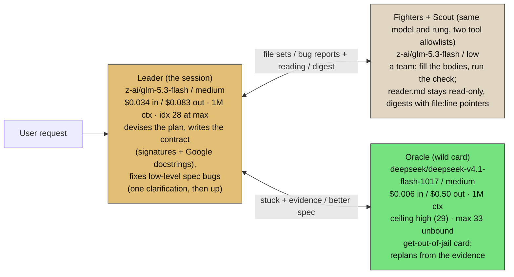
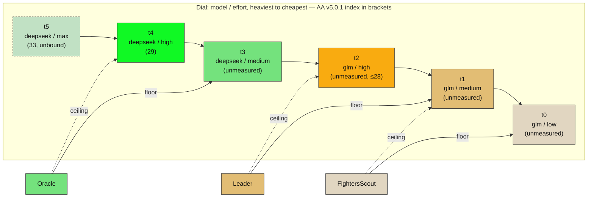

# Party, duo (final 2026-11-08): two models, three rungs

> **SUPERSEDED 2026-11-08** by the solo pin: one model (glm-5.3-flash) at three
> rungs — scout+fighter low, leader medium, oracle high. DeepSeek demoted to
> heavy-slot fallback after the digest economics (DS wins only below a 6.7%
> output/input ratio; GLM's 6×-cheaper output wins the bloat failure mode).
> Authoritative: `party-solo.md` + `solo-tiers.svg`. Kept as history.

The successor to `trifecta.md`. Four roles, two models: **GLM-5.3-flash** runs the
middle of the dial and the floor, **DeepSeek V4.1 Flash 1017** owns the top. The
Scout shares the Fighters' model and rung — two roles with distinct tool
allowlists (`reader.md` stays read-only, `doer.md` keeps edit), not a merged role.

Oracle correction (operator, 2026-11-08): the Oracle sits at **deepseek/medium**
with `high` as its ceiling — `high` (29) and `max` (33) are headroom above the pin,
not the pin itself.

Qwen3.8-Flash is fallback candidate only: 4.4× GLM's input price in the most
input-heavy lane, no `reasoning_effort` dial, unscored on AA v5.0.1.

Prices: OpenRouter live list, 2026-11-07. Indices: AA Intelligence Index v5.0.1,
2026-11-07. `unmeasured` = AA has not published that rung.

## Diagram 1 — the party and the flow

The Oracle sits on a different vendor than the Leader on purpose: the re-plan is a
read that does not share the Leader's blind spots. It is also the only lane that
pays $0.50/M output — rare calls by construction (`escalation.leader_attempts = 1`),
so the ladder's headroom is cheap.

## Diagram 2 — the dial

t5 is dashed: `max` is not in `effort_map` yet. Adding `max = "max"` gives the
Oracle a ceiling of 33 — the one upgrade this binding holds in reserve.

## Price and index card (OpenRouter + AA v5.0.1, 2026-11-07)

| model | lanes | $/M in | $/M out | cache | ctx | dial | AA v5.0.1 |
|---|---|---|---|---|---|---|---|
| deepseek/deepseek-v4.1-flash-1017 | oracle (+ light fallback) | 0.006 | 0.50 | 0.005 | 1M | low/high/max | 33 max · 29 high · 19 non-reasoning |
| z-ai/glm-5.3-flash | leader, fighters, scout | 0.034 | 0.083 | 0.03 | 1M | low/high/max | 28 max · med/low unmeasured |
| qwen/qwen3.8-flash | fallback only | 0.15 | 0.47 | 0.016 | 1M | none | unscored |

## Windows

| Window | Fighters + Scout | Leader | Oracle | What happened |
|---|---|---|---|---|
| t0..t4 (full) | glm/low → med | glm/med → high | ds/med → high | two roles share the floor rung; three distinct rungs above |
| t1..t4 (min = glm/med) | glm/med | glm/med → high | ds/med → high | floor lifts onto the Leader's rung; the party is only gear |
| t0..t2 (no deepseek) | glm/low → med | glm/med → high | glm/high | the Oracle clamps onto the Leader's ceiling; nobody above, the Leader keeps the problem |

## What owns what

- Policy: `~/.harness/tiers.toml` → `[binding.openrouter]` (L0=L1=glm, L3=ds),
  `[role.*]` (reader L0/low, doer L1/low, leader L1/medium, oracle L3/medium ceiling high).
- Render: `python adapter.py --target agents --apply` → `~/.config/opencode/agents/{reader,doer,oracle}.md`
  + `opencode.json` (`default_agent = orchestrator`, glm/medium).
- Picture: `duo-tiers.svg` (Diagram 1 rendered to the party-lane template).
- History: `trifecta.md` / `trifecta-tiers.svg` carry SUPERSEDED banners.

## Open, by design

1. The 20-task gate: GLM low/medium/high and DS medium are unmeasured rungs; the
   gate covers them in one pass on the operator's own traffic (`usage.cost`).
2. Oracle ceiling: `max` (33) is one `effort_map` line away from being reachable.
3. Claude re-pin: `role.doer` at L1 leaves the claude doer squashed into the leader
   (sonnet/medium) — recorded in the anthropic binding note, awaiting the operator.
