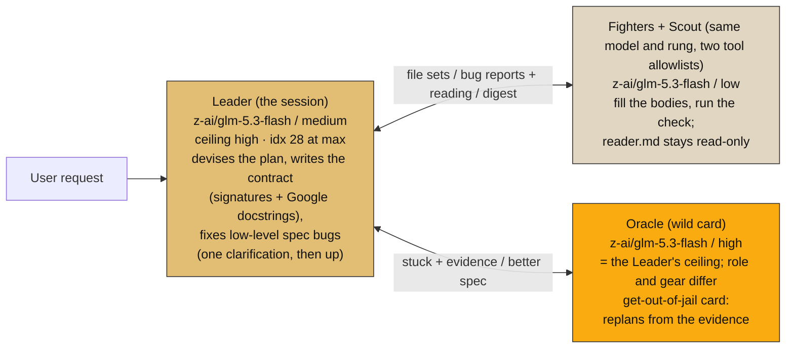
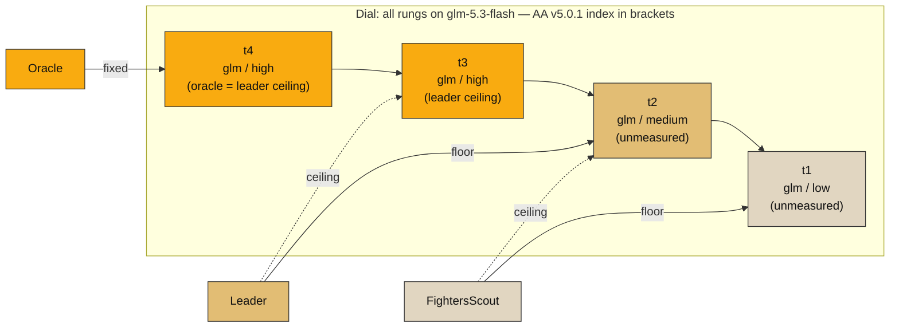

# Party, solo (final 2026-11-08): one model, three roles

The successor to `party-duo.md`. Four roles, one model: **GLM-5.3-flash** at three
rungs — `low` carries the Fighters and the Scout (two roles, distinct tool
allowlists: `reader.md` stays read-only), `medium` is the Leader (ceiling high),
`high` is the Oracle. This is `party-2-models.md`'s documented top shape: a widened
Leader reaches the Oracle's rung; they differ in role and gear, not brain.

Why not DeepSeek as the scout (the economics, settled): DS wins only while digest
output stays under **6.7% of input** — worth ~0.1 cent per call. GLM's 6×-cheaper
output ($0.083 vs $0.50) wins the scout's actual failure mode (bloated digest),
and a cheap weak reader is repaid in leader re-reads — the leader is the every-turn
lane. One model also means one gate run, one cache prefix, one vendor.

Fallbacks (candidates, not pins): heavy slot → `glm-5.3` full (idx 32, $0.07/$1.40)
then `deepseek-1017` (29 high / 33 max, $0.006/$0.50); light slot → `qwen3.8-flash`
(no dial, unscored, 4.4× GLM input).

Prices: OpenRouter live list, 2026-11-07. Indices: AA Intelligence Index v5.0.1.
`unmeasured` = AA has not published that rung.

## Diagram 1 — the party and the flow

## Diagram 2 — the dial

The ladder's honest weakness, stated: the Oracle tops out at glm's measured max
(28). If the gate ever shows the Oracle underperforming the widened Leader, the
upgrade is a candidates-list swap, not a redesign: `glm-5.3` full (32) or
`deepseek-1017` (29/33) into L3. And if OpenRouter accepts `effort: "max"` on
glm-5.3-flash (unverified), adding `max` to `effort_map` restores a rung above the
Leader's ceiling on the same model.

## Price card (OpenRouter, 2026-11-07)

| model | role in binding | $/M in | $/M out | cache | AA v5.0.1 |
|---|---|---|---|---|---|
| z-ai/glm-5.3-flash | ALL lanes: scout+fighter low, leader med, oracle high | 0.034 | 0.083 | 0.03 | 28 max · med/low unmeasured |
| z-ai/glm-5.3 | heavy fallback (oracle upgrade path) | 0.07 | 1.40 | 0.069 | 32 max |
| deepseek/deepseek-v4.1-flash-1017 | heavy fallback | 0.006 | 0.50 | 0.005 | 33 max · 29 high |
| qwen/qwen3.8-flash | light fallback | 0.15 | 0.47 | 0.016 | unscored, no dial |

## What owns what

- Policy: `~/.harness/tiers.toml` → `[binding.openrouter]` L0=L1=L2=L3=glm-5.3-flash,
  dial `[[L0,low],[L1,low],[L1,medium],[L1,high],[L3,high]]`, `resolved = 2026-11-08`.
- Render: `python adapter.py --target agents --apply` → `agents/{reader,doer,oracle}.md`
  + `opencode.json` (default_agent orchestrator, glm/medium).
- Picture: `solo-tiers.svg`. History: `party-duo.md`, `duo-tiers.svg`, `trifecta.*`
  carry SUPERSEDED banners.

## Open, by design

1. The 20-task gate — glm low/medium/high all unmeasured; one pass settles the ladder.
2. `max` effort probe — if accepted, the Oracle gets a rung above the Leader again.
3. Claude re-pin — `role.doer` at L1 still leaves the claude doer squashed into the
   leader (sonnet/medium), recorded in the anthropic binding note.
