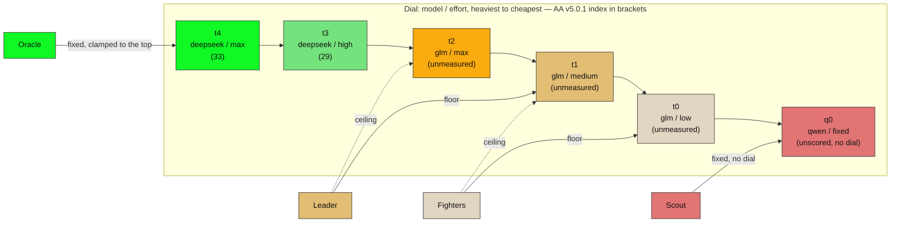

# Trifecta dial — the same dial as `trifecta.md` Diagram 2, rendered standalone

Prices (OpenRouter, 2026-11-07): deepseek-1017 $0.006 in / $0.50 out ·
glm-5.3-flash $0.034 / $0.083 · qwen3.8-flash $0.15 / $0.47. Indices (AA v5.0.1,
2026-11-07): 33 and 29 measured; the amber rungs and q0 are not.
