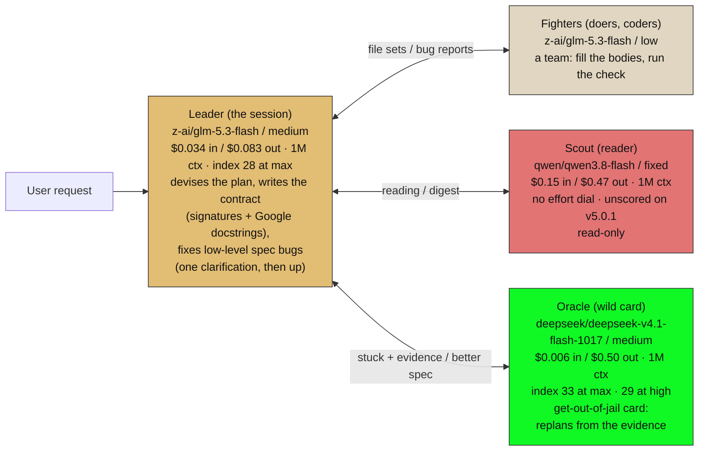
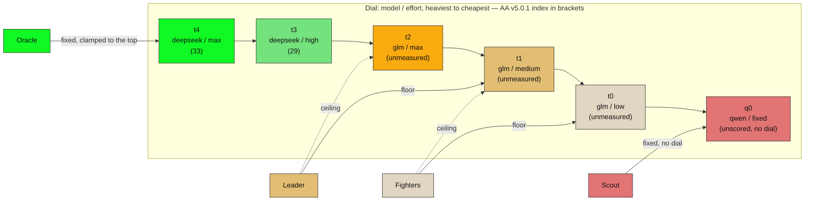

# Party, OpenRouter trifecta: three cheap brains, three vendors

> **SUPERSEDED 2026-11-07** by the duo pin: scout+fighter share `glm-5.3-flash/low`
> (chosen squash), leader `glm/medium`, oracle `deepseek-1017/high`, qwen3.8-flash
> demoted to fallback. Authoritative: `party-duo.md` + `duo-tiers.svg`. Kept as history.

Same four classes and the same flow as `party-3-models.md`. This binding is the
operator's decision of 2026-11-07: the **Leader** and **Fighters** share
GLM-5.3-Flash (mid slot, amber) at different rungs, the **Oracle** gets
DeepSeek V4.1 Flash 1017 (heavy slot, green) clamped at max, and the **Scout**
stays on Qwen3.8-Flash (light slot, red) at its one fixed effort. Three models,
three vendors, nothing above $0.50/M output on the OpenRouter route.

Prices: OpenRouter live model list, 2026-11-07. Indices: Artificial Analysis
Intelligence Index **v5.0.1**, retrieved 2026-11-07. Rungs AA has not measured
are marked `unmeasured`; a model AA has not scored at all is `unscored`. Do not
compare these numbers with the v4.3.2 / v4.1.1 figures in older notes — the
index was re-scaled.

## Diagram 1 — the party and the flow



A Fighter that hits a bug reports it. The Leader gets one clarification attempt;
only what he cannot resolve goes up to the Oracle, who replans from the evidence.
His better spec comes back to the Leader to be re-cut into file sets. The Oracle
sits on a different vendor than the Leader on purpose: the re-plan is a read that
does not share the Leader's blind spots. The cost of that hedge is recorded in
the price card — the every-turn lanes run on the mid model's $0.034 input while
the cheapest input token on the board ($0.006) is reserved for the rare call.

## Diagram 2 — the dial, and where each class sits



The green rungs are the only ones with published numbers: deepseek max 33, high
29. The amber rungs are the bet: AA scores GLM-5.3-Flash only at max (28), so
medium and low sit below 28 by ladder shape but unmeasured. q0 is off the ladder
entirely — Qwen3.8-Flash has no effort dial, so the Scout cannot be slid; it is
a fixed brain, not a rung.

## Price and index card (OpenRouter list + AA v5.0.1, both 2026-11-07)

| model | slot | $/M in | $/M out | cache $/M | ctx | dial | AA v5.0.1 |
|---|---|---|---|---|---|---|---|
| deepseek/deepseek-v4.1-flash-1017 | heavy | 0.006 | 0.50 | 0.005 | 1M | low/high/max | 33 max · 29 high · 19 non-reasoning |
| z-ai/glm-5.3-flash | mid | 0.034 | 0.083 | 0.03 | 1M | low/high/max | 28 max · medium/low unmeasured |
| qwen/qwen3.8-flash | light | 0.15 | 0.47 | 0.016 | 1M | none (fixed) | unscored (v4.3.2-era: ~2 below GLM, different scale) |

AA cost per Intelligence-Index task, at AA's own assumed prices: deepseek-1017
max $0.60, glm-5.3-flash max $0.58. OpenRouter's list prices are far below the
median-provider prices AA assumes (deepseek input is 48× cheaper), so the real
per-task cost through this route is a fraction of those figures — unmeasured,
and exactly what the 20-task gate should produce.

## Windows: min, max, squash, scale

| Window | Scout | Fighters | Leader | Oracle | What happened |
|---|---|---|---|---|---|
| t0..q0 (full) | qwen/fixed | glm/low → med | glm/med → max | ds/max | four brains, three vendors |
| t1..t4 (min = glm/med) | glm/med | glm/med | glm/med → max | ds/max | **squash**: the Scout lifts onto the Fighters' floor and the two become one role; q0 falls out of the window |
| t0..t3 (max = ds/high) | qwen/fixed | glm/low → med | glm/med → max | ds/high | the Oracle loses its top rung: 29, not 33 |
| t0..t2 (no deepseek) | qwen/fixed | glm/low → med | glm/med → max | glm/max | **squash**: the Oracle clamps onto the Leader's ceiling; there is nobody above |

## Not slotted

- `stepfun/step-3.7-flash` — no v5.0.1 index (AA page: N/A, model deprecated);
  $0.20/$1.15, 262k ctx. Its elite row is tau2-bench 98.5 (multi-turn tool
  calling). Successor `Step 5 Preview` scores 29 at $2.35/task. Bench for the
  Leader lane if tool-loop reliability, not index, becomes the bottleneck.
- `qwen/qwen3.8-27b` — index 20 at xhigh ($0.15/$1.875): below GLM-5.3-Flash's
  28. The "PhD" label does not survive v5.0.1. No slot.
- `google/gemini-3.8-flash` — index 31 at high, $0.825/$4.125, $7.77/task:
  +3 over GLM for 13× the cost. No slot.
- `z-ai/glm-5.3` (full) — index 32 at max ($0.07/$1.40 on this route): one point
  under the Oracle's 33 at 17× the output price. No slot.

## Open, by design

1. The amber ladder (glm medium/low) and the deepseek medium rung are
   unmeasured. The party lives on those rungs.
2. Qwen3.8-Flash is unscored on v5.0.1 and has no dial; "one rung lower effort"
   is not expressible for the Scout. It is fixed, or it is not the Scout.
3. Both are settled by the same gate: 20 of the operator's own reader/leader
   tasks, one rubric, read `usage.cost`. Done before the binding is marked
   verified, not after.

## Two-model collapse (vs the three-model pin)

The 2-model party is not a second binding — it is the same dial rendered with a
ceiling that excludes the heavy lane:

```
python render_agents.py --harness opencode --provider openrouter --leader --window 0:3 --apply
```

Window `0:3` removes deepseek from reach. The Oracle clamps from step 4 to step 3:
**glm-5.3-flash / high** — the Leader's own model, one rung above the Leader's
medium floor. Leader and Oracle then "think at the same level and differ only in
role and gear," exactly the `party-2-models.md` squash-at-the-top behaviour.
The renderer prints the clamp as an explicit warning, so the collapse is recorded
in every artifact it writes.

| | 3-model (window 0:5, LIVE) | 2-model (window 0:3) |
|---|---|---|
| Scout | qwen3.8-flash / low | qwen3.8-flash / low |
| Fighters | glm-5.3-flash / low | glm-5.3-flash / low |
| Leader | glm-5.3-flash / medium | glm-5.3-flash / medium |
| Oracle | deepseek-1017 / medium | **glm-5.3-flash / high** |
| vendors | 3 | 2 |
| oracle headroom | 29–33 (measured) | 28 (glm max, unmeasured below it) |
| hedge | oracle blind spots differ | none — same brain, more gears |

## Final pin (operator, 2026-11-07)

Oracle **deepseek-v4.1-flash-1017 / medium** — max (33) and high (29) kept as
unbound headroom above it. Leader glm-5.3-flash / medium. Fighters
glm-5.3-flash / low. Scout qwen3.8-flash / low — nominal: qwen has no dial, so
that rung is a floor, not a slide. The rendered truth is `trifecta-tiers.svg`
(the three-lane party-on-a-dial infographic, hand-tuned from the party template
with OpenRouter prices and AA v5.0.1 indices, dated 2026-11-07); Diagram 1 above
now matches. The dial Diagram 2 still shows the Oracle clamped at t4 — regenerate
it from the final pin when the gate passes.
